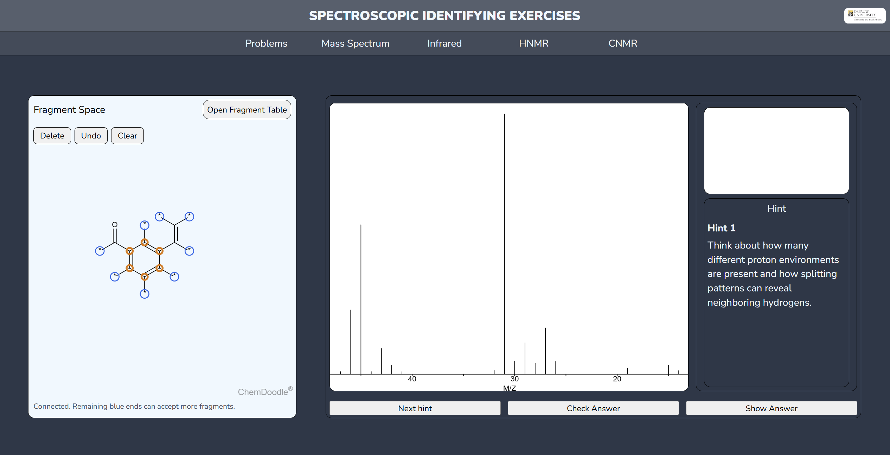
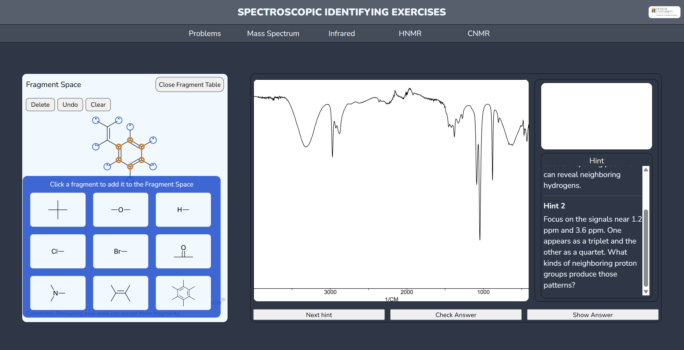
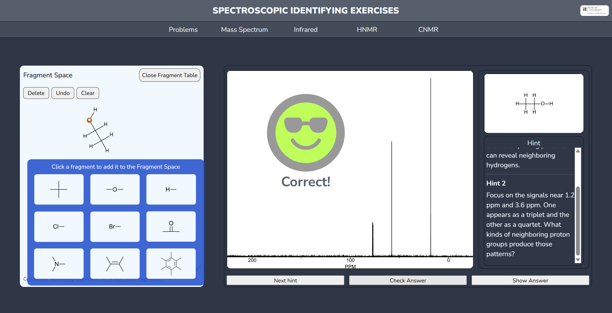
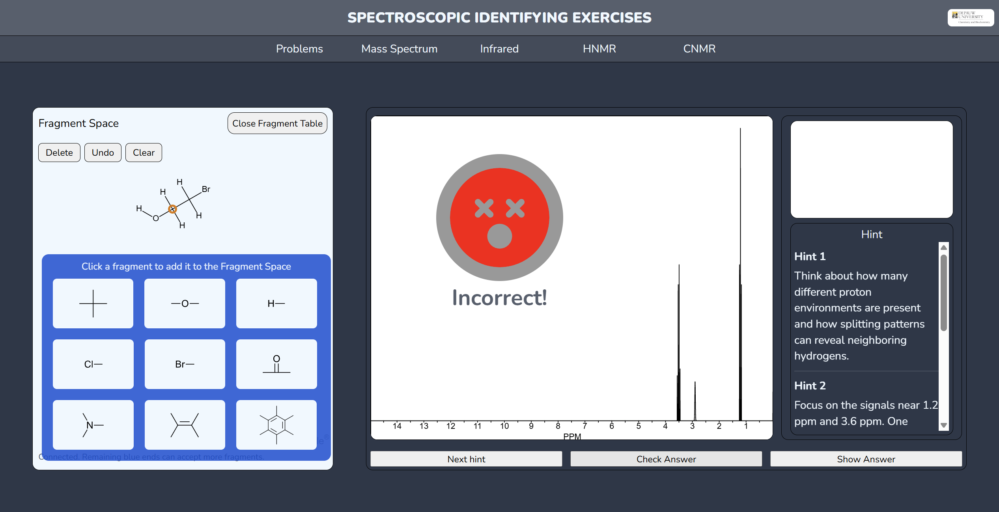

# Spectroscopic Identifying Exercise App

> [!WARNING]
> This API is no longer used. JCAMP merging and peak detection for JCAMP-DX builder is now handled locally.: Update ChemDoodle library is NOT recommended: The current library has been modified

A web-based interactive spectroscopy exercise for identifying organic compounds from MS, IR, HNMR, and C NMR data, with progressive hints, a fragment-based structure builder, and answer feedback.

